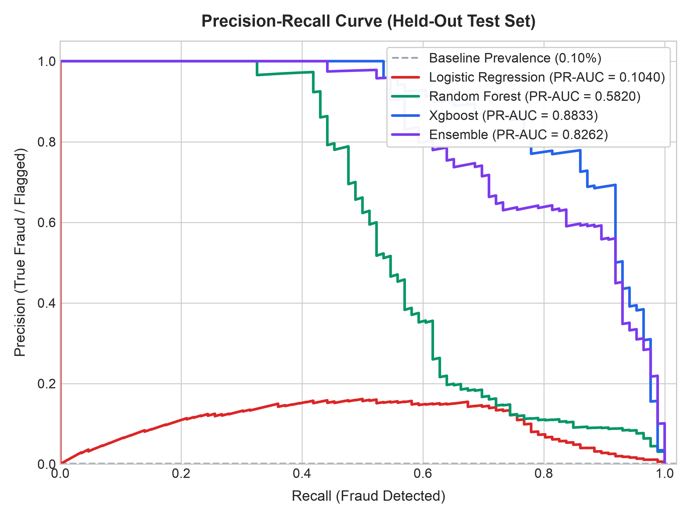
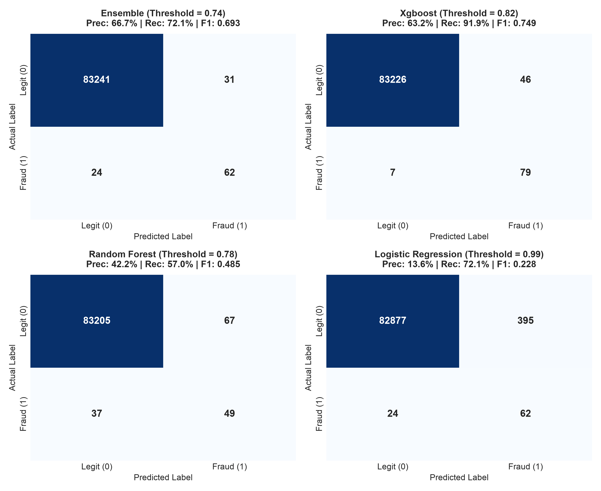
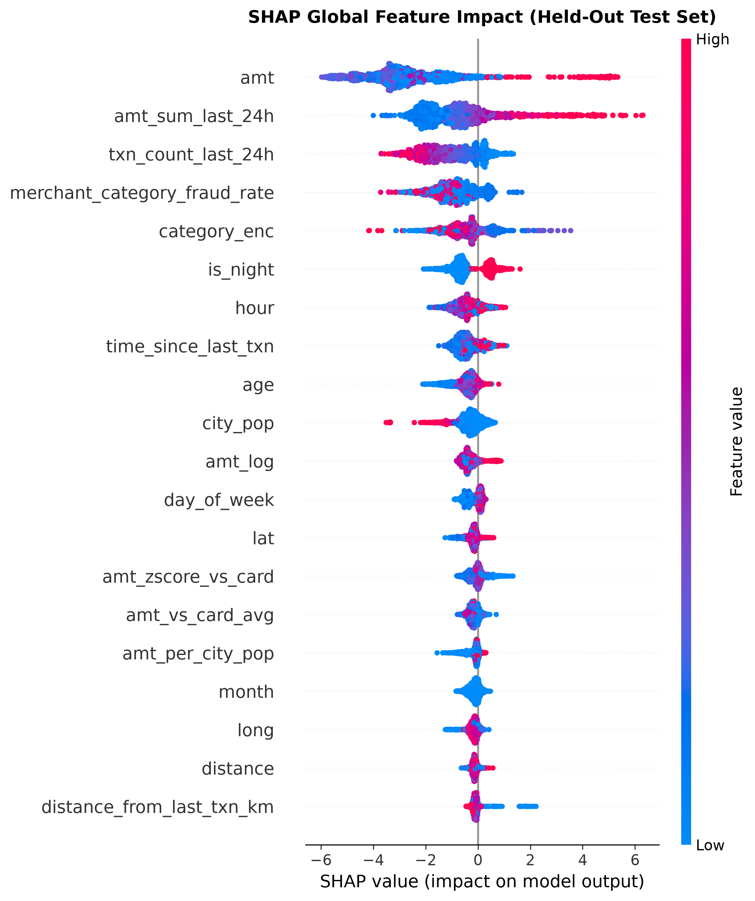
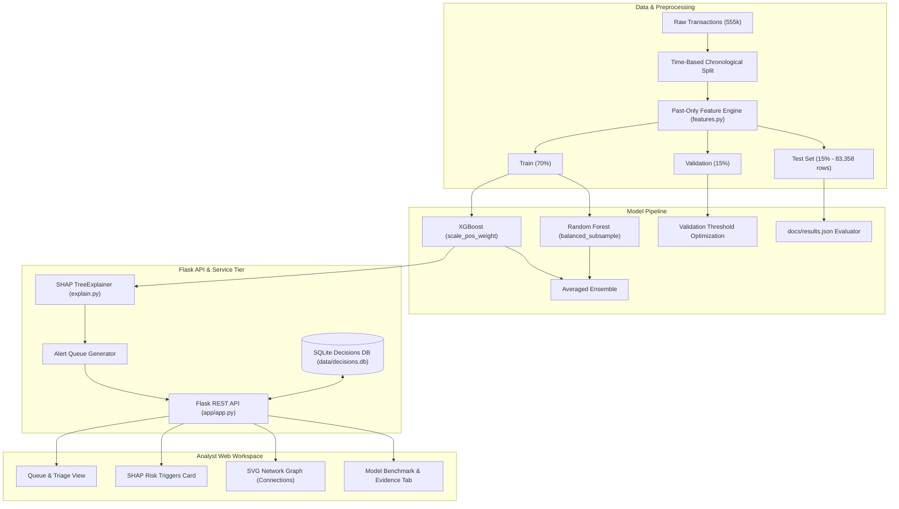

# Sentra — Fraud Detection & Alert Investigation Platform

An ML-powered fraud detection and alert investigation prototype designed to detect fraudulent credit card transactions, minimize financial loss under severe class imbalance, and deliver transparent, SHAP-driven explanations for fraud analysts.

[](tests/)
[](requirements.txt)
[](models/)
[](LICENSE)

---

## 📸 Interface Preview

<!-- Screenshot / GIF Placeholders -->
| Alert Investigation Dashboard | SHAP Explainability & Risk Triggers |
| :---: | :---: |
| <br>*(Placeholder: Sentra Alert Investigation Queue & Velocity Timeline)* | <br>*(Placeholder: Real-Time SHAP Risk Factors & Plain-English Rationale)* |

| Dynamic Entity Graph (Connections) | Model Evaluation & Cost Evidence |
| :---: | :---: |
| <br>*(Placeholder: Interactive SVG Card-Merchant-City Network Graph)* | <br>*(Placeholder: PR-AUC Benchmarks & Financial Cost Curves)* |

---

## 🎯 Problem Statement

Detecting credit card fraud is an asymmetric learning challenge:

1. **Extreme Class Imbalance:** In real transaction streams, legitimate transactions vastly outnumber fraudulent ones (often < 0.2%). Standard classification accuracy is misleading: a naive model predicting 100% legitimate transactions achieves > 99.8% accuracy while missing every single fraud event.
2. **Cost Asymmetry:** The costs of prediction errors are heavily unbalanced:
   - **False Negative (FN):** Direct financial liability for the stolen funds (average fraud loss: **$582.99** in this dataset).
   - **False Positive (FP):** Operational cost of human investigation and customer friction (estimated at **$5.00** per manual alert review).
   Missing a fraudulent transaction is over **116x more costly** than erroneously reviewing a legitimate one.
3. **Black-Box Alert Fatigue:** Security analysts cannot act on raw probability scores alone. To freeze accounts or file SARs, investigators require immediate, plain-English feature attributions showing *why* a transaction was flagged.

---

## 📊 Dataset

- **Source:** [Credit Card Fraud Detection Dataset 2020 on Kaggle](https://www.kaggle.com/datasets/kartik2112/fraud-detection)
- **Nature of Data:** **Simulated Data** — Generated via the open-source **Sparkov Data Generation** tool by Brandon Harris. It simulates synthetic customer profiles, merchant categories, geographic coordinates, and fraudulent transaction patterns across US credit cards. No real cardholder PII is present.
- **Corpus Size:** 555,719 total transactions chronologically ordered across 2020.
- **Test Set Size:** **83,358** transactions held out chronologically.
- **Fraud Rate:** **0.1032%** in the held-out test set (86 fraudulent transactions vs. 83,272 legitimate transactions).
- **Financial Baseline:** Total fraud loss exposure in the test set is **$50,137.18** with an average fraud amount of **$582.99** (vs. legitimate transaction average of **$68.54**).

---

## ⚙️ Methodology & Approach

### 1. Leakage-Free Time-Based Split
Random k-fold cross-validation causes temporal leakage in transaction streams because future transactions leak customer spending habits back into training data. We enforce a strict chronological split:

```
[──────── 70% Train (389,003 txns) ────────] [── 15% Val (83,358 txns) ──] [── 15% Test (83,358 txns) ──]
  2020-06-21 12:14  ───>  2020-11-20 18:25     2020-11-20  ───>  2020-12-13     2020-12-13  ───>  2020-12-31
```

- **Temporal Assertion:** `max(train_timestamp) < min(val_timestamp)` and `max(val_timestamp) < min(test_timestamp)`.
- **Preprocessors & Encoders:** All scalers, category frequency tables, and fraud rate mappings are fitted **exclusively on the training split** and applied downstream.
- **Zero Future Leakage:** All customer historical rolling metrics are computed using strictly past transactions (`shift(1)` and rolling time windows that exclude the current row).

### 2. Feature Engineering

| Feature | Type | Description |
|---|---|---|
| `amt` | Numeric | Transaction amount in USD |
| `amt_log` | Numeric | $\ln(1 + \text{amt})$ heavy-tail transformation |
| `amt_per_city_pop` | Numeric | Transaction amount divided by cardholder city population |
| `distance` | Numeric | Haversine distance (km) between cardholder coordinates and merchant location |
| `hour`, `day_of_week`, `month` | Temporal | Extracted cyclical timestamp components |
| `age` | Demographic | Cardholder age calculated from date of birth at transaction timestamp |
| `gender_enc`, `category_enc` | Categorical | Label encoded demographics and merchant categories (fitted on train only) |
| `is_night` | Indicator | Binary flag: 1 if transaction occurred between 10:00 PM and 5:00 AM |
| `is_weekend` | Indicator | Binary flag: 1 if transaction occurred on Saturday or Sunday |
| `txn_count_last_1h` | Behavioral Velocity | Number of transactions on this card in the preceding 1 hour (past only) |
| `txn_count_last_24h` | Behavioral Velocity | Number of transactions on this card in the preceding 24 hours (past only) |
| `amt_sum_last_24h` | Behavioral Velocity | Total dollar spend on this card in the preceding 24 hours (past only) |
| `time_since_last_txn` | Behavioral Velocity | Elapsed seconds since this cardholder's previous transaction |
| `amt_vs_card_avg` | Historical Profile | Ratio of current amount to cardholder's historical expanding average |
| `amt_zscore_vs_card` | Historical Profile | Z-score of amount against cardholder's historical mean and standard deviation |
| `is_new_merchant_for_card` | Behavioral Profile | Binary flag: 1 if this card has never transacted with this merchant before |
| `distance_from_last_txn_km` | Spatial Velocity | Haversine distance from the geographic coordinates of previous transaction |
| `merchant_category_fraud_rate` | Target Encoding | Historical fraud rate of merchant category (computed strictly on train set) |

*All leaking identifier fields (`cc_num`, `trans_num`, cardholder names, street addresses, exact DOB) are removed from the feature matrix.*

### 3. Models Compared & Imbalance Handling
- **Logistic Regression Baseline:** Standardized features, L2 penalty, weighted by `class_weight='balanced'`.
- **Random Forest:** 60 estimators, `max_depth=10`, balanced subsample reweighting (`class_weight='balanced_subsample'`).
- **XGBoost Classifier:** 140 gradient-boosted trees, `max_depth=6`, `learning_rate=0.12`, subsampling 0.85, with positive class weight scaled by `scale_pos_weight = 218.03` (ratio of negative to positive training cases).
- **Averaged Ensemble:** Soft probability averaging combining the two strongest models (XGBoost + Random Forest).

---

## 📈 Results & Evaluation

All metrics are computed strictly on the held-out **83,358 test transactions** (86 ground-truth fraud cases). Primary optimization is **PR-AUC (Average Precision)** rather than ROC-AUC, reflecting real operational performance under severe class imbalance.

### Benchmark Comparison

*Values computed directly from [docs/results.json](file:///Users/sravanthimalothu/Desktop/FraudDecetion/docs/results.json):*

| Model | PR-AUC (95% CI) | ROC-AUC (95% CI) | Optimal Threshold | Precision (95% CI) | Recall (95% CI) | F1-Score | Confusion Matrix (TN / FP / FN / TP) | Total Cost (Savings vs Baseline) |
|---|:---:|:---:|:---:|:---:|:---:|:---:|:---:|:---:|
| **XGBoost** | **0.8833**<br>(0.8244 – 0.9304) | **0.9994**<br>(0.9987 – 0.9999) | **0.8242** | **0.6320**<br>(0.5462 – 0.7118) | **0.9186**<br>(0.8494 – 0.9747) | **0.7488** | 83,226 / 46 / **7** / **79** | **$4,310.93**<br>(**91.40% savings**) |
| **Averaged Ensemble** | 0.8262<br>(0.7503 – 0.8804) | **0.9996**<br>(0.9993 – 0.9998) | 0.7408 | 0.6667<br>(0.5672 – 0.7619) | 0.7209<br>(0.6196 – 0.8129) | 0.6927 | 83,241 / 31 / 24 / 62 | $14,146.77<br>(71.78% savings) |
| **Random Forest** | 0.5820<br>(0.4841 – 0.6748) | 0.9969<br>(0.9955 – 0.9979) | 0.7752 | 0.4224<br>(0.3333 – 0.5000) | 0.5698<br>(0.4685 – 0.6687) | 0.4851 | 83,205 / 67 / 37 / 49 | $21,905.65<br>(56.31% savings) |
| **Logistic Regression** | 0.1040<br>(0.0782 – 0.1362) | 0.9884<br>(0.9826 – 0.9933) | 0.9900 | 0.1357<br>(0.1053 – 0.1632) | 0.7209<br>(0.6318 – 0.8239) | 0.2284 | 82,877 / 395 / 24 / 62 | $15,966.77<br>(68.15% savings) |

*(Note: LightGBM was not evaluated as it was not installed in this environment).*

### Financial Cost Analysis
- **Unmitigated Baseline Loss:** **$50,137.18** (all 86 fraud cases missed).
- **XGBoost Policy Loss:** **$4,310.93** (7 missed frauds × $582.99 + 46 false alarm reviews × $5.00).
- **Net Cost Reduction:** **$45,826.25** saved (**91.40%** loss reduction).

### Evaluation Visualizations

| Precision-Recall Curves (Held-Out Test Set) | Confusion Matrix Heatmap (All Models) |
| :---: | :---: |
|  |  |

---

## 🔍 Explainability & Alert Attribution

To eliminate black-box friction, every alert generated is processed by a SHAP (`TreeExplainer`) interpreter that decomposes model output into exact directional contributions and plain-English reasons.

### Global SHAP Feature Importance
The summary plot highlights that relative spending deviation (`amt_vs_card_avg`), raw amount (`amt`), category fraud rates, and velocity intervals dominate the model's decision boundary:



### Example Real Alert Explanation

When scoring transaction **ALT-10482** ($978.43 in `shopping_net`), `explain_transaction()` extracts the top contributing drivers:

```json
{
  "alert_id": "ALT-10482",
  "risk_score": 98,
  "risk_level": "High risk",
  "probability": 0.982,
  "top_features": [
    {
      "feature": "amt",
      "value": 978.43,
      "shap_value": 3.84,
      "impact": "increases_risk",
      "reason": "Amount ($978.43) is significantly higher than typical transactions."
    },
    {
      "feature": "amt_vs_card_avg",
      "value": 8.42,
      "shap_value": 2.15,
      "impact": "increases_risk",
      "reason": "Transaction is 8.4x higher than this card's historical average."
    },
    {
      "feature": "merchant_category_fraud_rate",
      "value": 0.038,
      "shap_value": 1.42,
      "impact": "increases_risk",
      "reason": "Merchant category (shopping_net) has elevated historical fraud risk."
    },
    {
      "feature": "time_since_last_txn",
      "value": 45.0,
      "shap_value": 0.95,
      "impact": "increases_risk",
      "reason": "Occurred only 45 seconds after previous card activity."
    },
    {
      "feature": "distance_from_last_txn_km",
      "value": 124.5,
      "shap_value": 0.62,
      "impact": "increases_risk",
      "reason": "Physical distance between consecutive transactions is 124.5 km."
    }
  ]
}
```

---

## 🏗️ System Architecture

The platform decouples ML feature engineering, inference, explainability, persistent analyst review storage, and presentation:



### API Endpoint Specification

| Method | Endpoint | Description |
|---|---|---|
| `GET` | `/health` | Service health status, active models, SQLite connectivity check, and model version |
| `GET` | `/api/alerts` | List of scored test-split alerts sorted descending by risk score (0–100) |
| `GET` | `/api/alerts/<id>` | Full investigation payload with SHAP triggers, customer profile, and connections |
| `POST` | `/api/alerts/<id>/decision` | Record analyst decision (`Approved`, `Rejected`, `Escalated`) stored in SQLite |
| `GET` | `/api/alerts/<id>/decisions` | Audit log of previous analyst decisions for a specific alert |
| `POST` | `/api/predict` | Real-time transaction scoring with input validation, SHAP explainability, and model version |
| `GET` | `/api/evidence` | Machine learning benchmarks and financial cost analysis from `docs/results.json` |
| `GET` | `/docs/<filename>` | Serves generated evaluation plots (PR curve, ROC, confusion matrix, SHAP summary) |

---

## 🚀 How to Run

### Option 1: Docker & Docker Compose (Recommended)

To run the containerized service with Gunicorn and persistent SQLite storage:

```bash
# Clone the repository
git clone https://github.com/your-username/FraudDetection.git
cd FraudDetection

# Build and start the container
docker-compose up --build
```
Access the dashboard at `http://localhost:5001`.

### Option 2: Local Setup

```bash
# 1. Create and activate virtual environment
python3 -m venv venv
source venv/bin/activate   # On Windows: venv\Scripts\activate

# 2. Install pinned dependencies
pip install -r requirements.txt

# 3. Run the automated test suite
pytest tests/ -v

# 4. Start the dashboard application
python app/app.py
```
Open `http://localhost:8080` (or `http://localhost:5001`) in your browser.

---

## ⚠️ Limitations

1. **Simulated Dataset:** Built on synthetic transaction records generated via Sparkov. While statistical distributions, merchant categories, and fraud patterns are realistic, synthetic data lacks the complex behavioral dynamics and evasion techniques of real human adversaries.
2. **Absence of Network & Device Telemetry:** The dataset contains no raw device identifiers, IP addresses, HTTP headers, or browser fingerprinting signals. All features are derived strictly from cardholder demographics, merchant categories, geography, and transaction velocity.
3. **Offline Batch Evaluation:** Models were validated on a static chronological test split. The setup does not simulate live streaming ingestion delays, partial transaction latency, or real-time distributed feature stores.
4. **Concept Drift Not Evaluated:** The held-out test split spans a 2-week window (December 13–31, 2020). Long-term macroeconomic seasonality, holiday purchasing spikes, and multi-quarter fraud pattern shifts were not evaluated over multi-year horizons.

---

## 🔮 Future Work

- **Streaming Feature Store:** Integrate Redis or Feast to compute rolling card velocities (`txn_count_last_1h`, `amt_sum_last_24h`) in sub-10ms production pipelines.
- **Graph Neural Networks (GNNs):** Model cardholder-merchant bipartite networks with PyTorch Geometric to detect syndicated fraud rings sharing mule merchants across multiple cards.
- **Continuous Drift Monitoring:** Implement population stability index (PSI) tracking and automated threshold recalibration triggers as fraud distributions shift.
- **Human-in-the-Loop Active Learning:** Route borderline predictions ($0.45 < p < 0.55$) into a priority queue for manual analyst labeling, feeding continuous retraining pipelines.

---

## 💻 Investigation Interface (Summary)

The prototype includes an analyst dashboard designed for fraud review:

- **Alert Queue:** Prioritized feed of flagged transactions sorted by risk score (0–100) descending.
- **Velocity Timeline:** Chronological progression of card activity preceding each alert.
- **Risk Triggers:** Top 5 SHAP-contributing features displayed with plain-English rationales.
- **Entity Graph (Connections):** Dynamic SVG network linking Cardholder $\to$ Merchant $\to$ Settlement City $\to$ Co-occurring Cards.
- **Evidence Panel:** Direct visual access to test-set PR curves, confusion matrices, and financial cost tradeoffs.
- **Decision Capture:** Instant action buttons (**Approve**, **Block / Freeze Card**, **Escalate**) permanently logged to SQLite.
